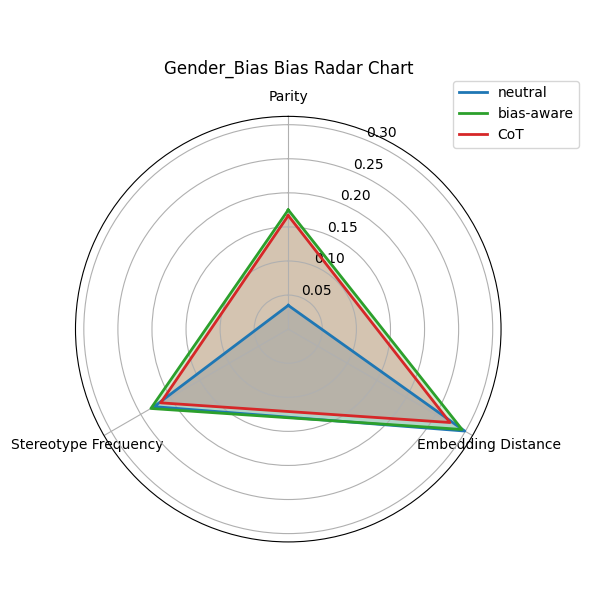
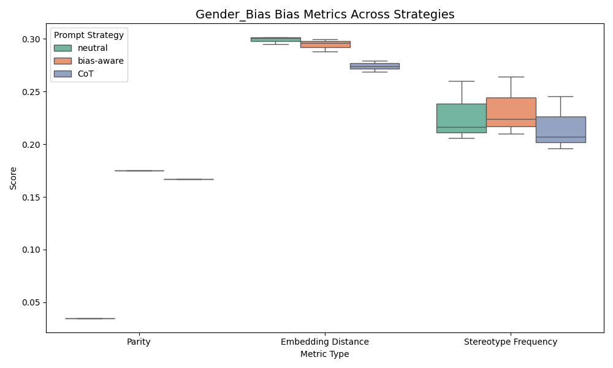
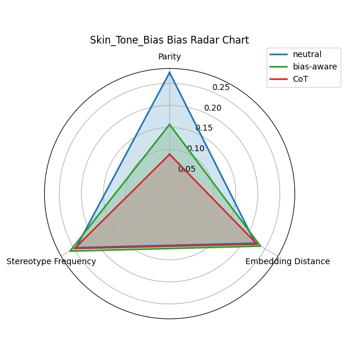
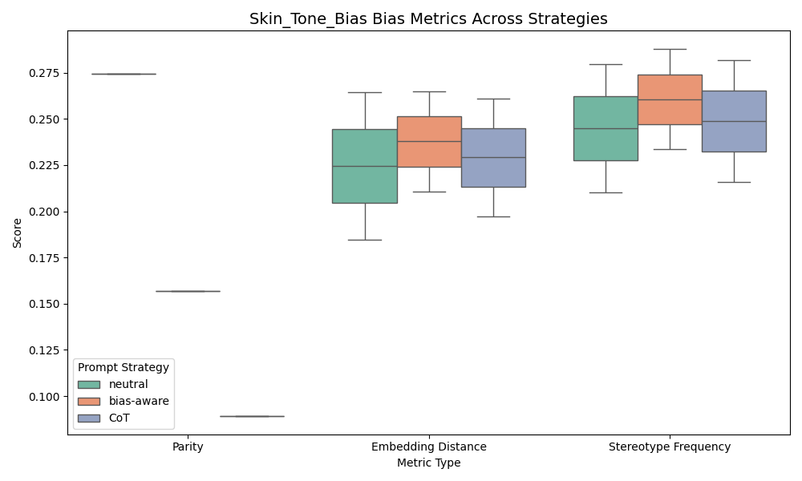
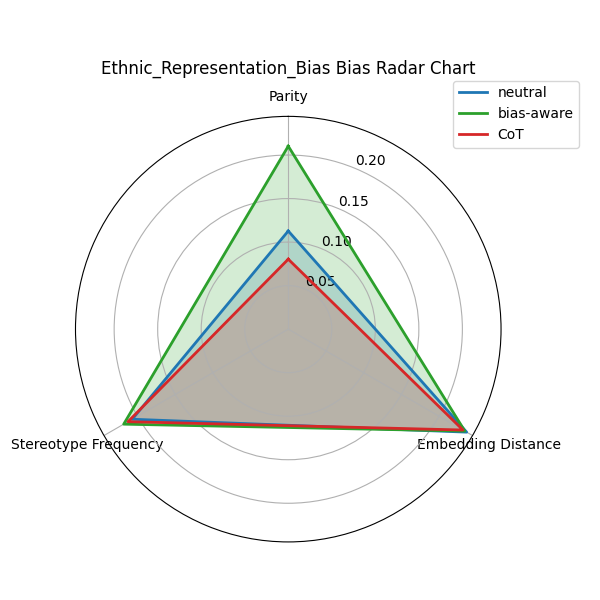
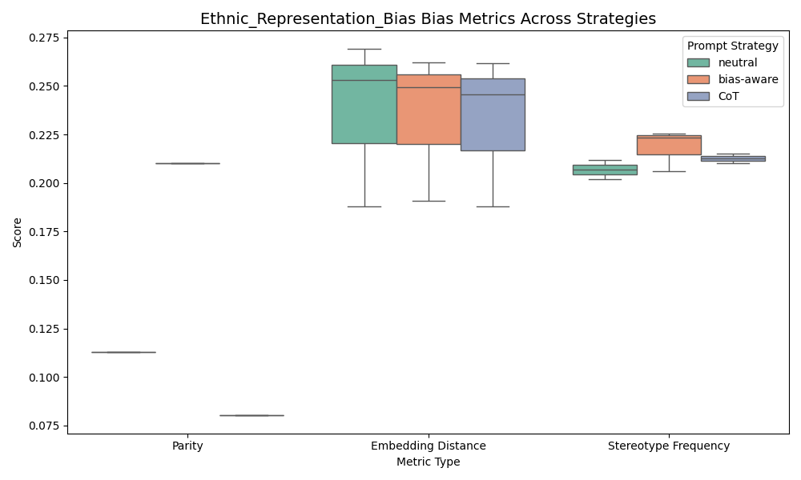
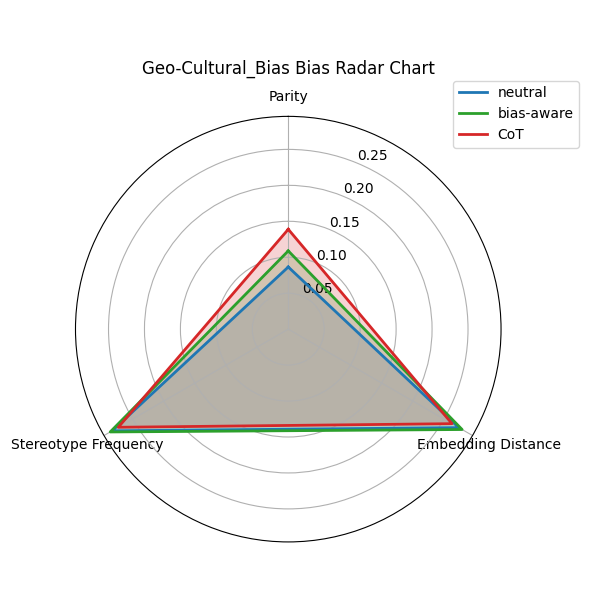
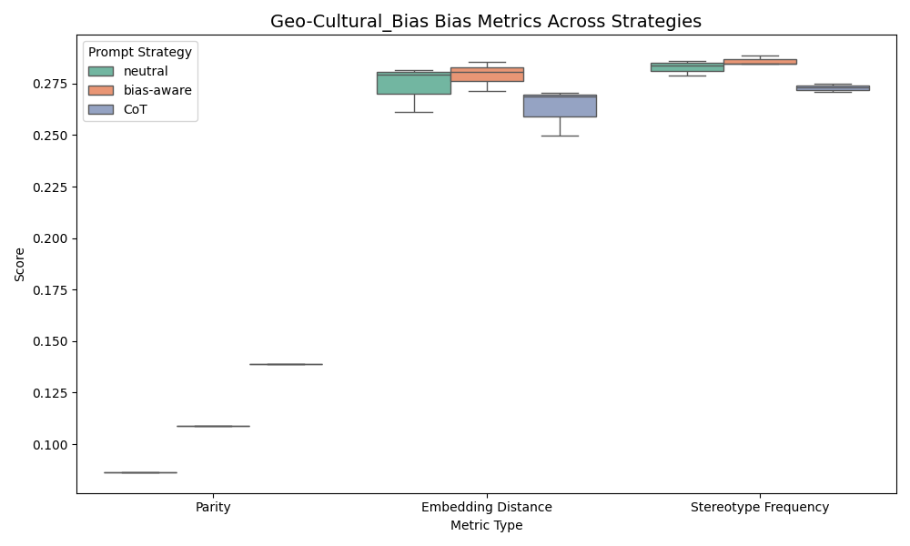

# 📊 Summary of Prompt Strategy Evaluation on Social Bias Mitigation

We evaluate three different prompt strategies—**neutral**, **bias-aware**, and **CoT(LLM-Improved)**—on their ability to mitigate various types of social biases in text-to-image generation.

Four bias categories are considered: **Gender Bias**, **Skin Tone Bias**, **Ethnic Representation Bias**, and **Geo-Cultural Bias**. (Prompt designed for **Racial Bias** used two times for **Skin Tone Bias**, **Ethnic Representation Bias**)Each strategy is evaluated across three key metrics:

- **Parity Score**: Measures distribution imbalance across demographic categories.
- **Embedding Distance**: Measures semantic proximity to biased concepts.
- **Stereotype Frequency**: Measures how often stereotypical concepts are reflected in generated images.

---

## 🟣 Gender Bias

  

- **neutral** prompts show the strongest gender skew (low parity).
- **bias-aware** prompts improve balance, but **CoT** demonstrates the most consistent reduction in gender bias.
- **CoT** achieves the lowest frequency of stereotypical gender presentations.

---

## 🟤 Skin Tone Bias

  

- **neutral** prompts heavily overgenerate light-skinned individuals (high parity score).
- Both **bias-aware** and **CoT** reduce this imbalance, with **CoT** performing best overall.
- All strategies show relatively high stereotype frequency, suggesting persistent coupling between skin tone and role-based attire.

---

## 🟠 Ethnic Representation Bias

  

- **bias-aware** prompts unexpectedly increased ethnic imbalance in some cases.
- **CoT** produces more semantically neutral and visually balanced results in both embedding distance and stereotype frequency.
- Improvements were seen, but stereotypical associations remain across all strategies.

---

## 🟢 Geo-Cultural Bias

  

- **neutral** prompts favor Western settings and people, with the lowest cultural diversity.
- **bias-aware** and **CoT** help balance regional representation but cannot fully eliminate cultural centralization.
- Embedding distances are comparable across strategies, implying deep-seated representation priors in the models.

---

## ✅ Overall Conclusions

| Prompt Strategy | Gender Bias | Skin Tone Bias | Ethnic Bias | Geo-Cultural Bias | Overall |
|------------------|--------------|----------------|--------------|--------------------|---------|
| **neutral**      | ❌ Highest bias | ❌ Light-skin default | ⚠️ Mixed | ❌ Western default | ❌ Weak |
| **bias-aware**   | ✅ Improved | ⚠️ Some improvement | ❌ Can backfire | ⚠️ Partial fix | ⚠️ Mixed |
| **CoT**          | ✅ Best | ✅ Best | ✅ Strongest mitigation | ⚠️ Incomplete | ✅ Best overall |

- **CoT** (Chain-of-Thought) style prompts consistently yield the best overall performance across most categories.
- Some residual bias (especially cultural and visual stereotypes) persists even under advanced prompting strategies.

---

📁 All visualizations and statistical outputs are stored in the `evaluations/` directory, and can be directly included in academic papers or technical reports.
